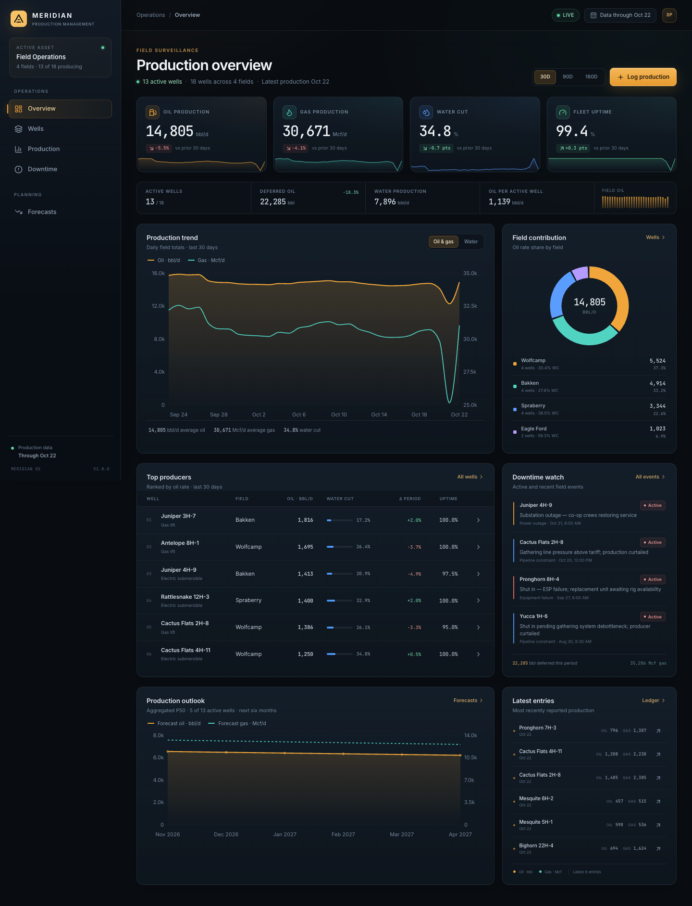
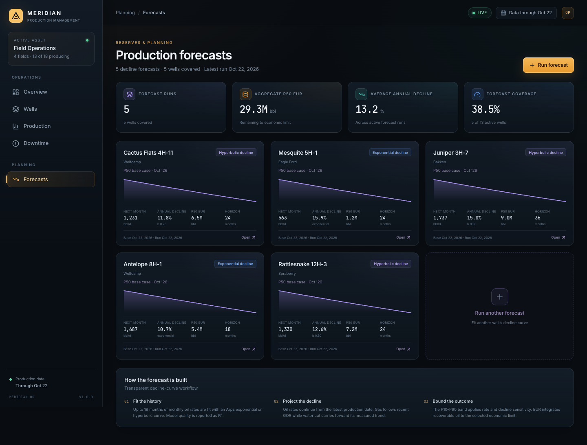

# Meridian — Production Management System

An oil & gas production management console for field surveillance, daily allocation, well performance, downtime and decline-curve forecasting. Built as a single deployable Spring Boot application with a React operations UI.



## Highlights

- **Field overview** — oil, gas, water, water cut, fleet uptime, active wells, deferred volumes, field contribution, top producers, recent downtime and a six-month outlook.
- **Well inventory & 360 view** — search, filter and manage 18 seeded wells; inspect rates, water cut, uptime, completion data and a 180-day production history.
- **Daily production ledger** — enter and edit daily oil, gas and water volumes, hours online, wellhead pressure, choke size and notes; filter by well, field and date; watch daily totals and uptime.
- **Downtime & deferment** — log active or resolved events by reason, auto-estimate deferred oil and gas from prior rates, and track reliability with reason breakdowns and daily outage hours.
- **Decline-curve forecasting** — fit exponential or hyperbolic Arps curves, project oil/gas/water, apply a P10–P90 band, estimate ultimate recovery to an economic limit, and compare actuals with the forecast.
- **Operational UX** — responsive dark control-room theme, keyboard-friendly dialogs, loading skeletons, empty states, toast feedback, server-side validation and accessible charts/tables.



## Stack

| Layer | Technology |
| --- | --- |
| Language | **Java 27** |
| Backend | **Spring Boot 4.2.0-M2** (Spring MVC, Spring Data JPA, Bean Validation, Actuator) |
| Database | **H2 2.5.252**, file-backed, schema managed by Hibernate |
| Frontend | **React 19.3.1**, TypeScript 7, Vite 8, React Router 7, Recharts 3, Lucide icons |
| Styling | Hand-written CSS with variable-driven dark theme and responsive breakpoints |
| Build | Maven 3.10+, npm; executable jar embeds the built React assets |
| Testing | JUnit 5, AssertJ, MockMvc, TypeScript/Vite production build |

> **React version note:** React 22 is not a published npm release at the time of writing. The registry's latest stable version is **19.3.1**, so that is what the project uses and pins. All React code is compatible with the standard modern API; update `frontend/package.json` when React 22 is available.

## Quick start

### Requirements

- JDK 27 (`java -version`)
- Maven 3.10+
- Node.js 22+ and npm (verified on Node 26)

### Run

```bash
./run.sh start
```

This installs frontend dependencies, builds the React UI, packages the jar and starts the application in the background.

- **Application (IPv4):** <http://127.0.0.1:8090>
- **Application (IPv6):** <http://[::1]:8090>
- **H2 console:** <http://localhost:8090/h2-console>
- **Health:** <http://localhost:8090/actuator/health>

Tomcat binds a dual-stack wildcard socket, so the UI and API are reachable over both loopback families. `run.sh` health checks probe `localhost`, `127.0.0.1` and `[::1]` automatically.

The database and demo data are created automatically on first launch. Stop it with:

```bash
./stop.sh
```

The standalone stop script resolves the PID file, removes stale entries, falls back to the verified listener on the configured port, sends `SIGTERM`, and escalates to `SIGKILL` only after a timeout. It refuses to kill processes that do not belong to Meridian.

To run in the foreground instead:

```bash
./run.sh
```

If port `8090` is busy:

```bash
PORT=8091 ./run.sh start
```

### Run script commands

| Command | What it does |
| --- | --- |
| `./run.sh` | Build UI + jar, then run in the foreground |
| `./run.sh start` | Build and run in the background; logs in `.run/pms.log` |
| `./run.sh stop` | Alias for `./stop.sh` |
| `./stop.sh` | Safely stop the background process |
| `./stop.sh --port 8091` | Stop an instance on a non-default port |
| `./run.sh restart` | Stop, rebuild and restart |
| `./run.sh status` | Show process and health status |
| `./run.sh dev` | Run Spring Boot + Vite with hot reload (UI at <http://localhost:5173>) |
| `./run.sh build` | Build the packaged jar without starting it |
| `./run.sh test` | Run backend tests and the frontend production build |

Environment variables: `PORT` (default `8090`), `SKIP_UI_BUILD=1` to reuse `frontend/dist`, `JAVA_OPTS` for JVM flags, and `STOP_TIMEOUT` for shutdown grace time.

### Stopping safely

```bash
./stop.sh                     # default port 8090
./stop.sh --port 8091
STOP_TIMEOUT=30 ./stop.sh
```

`stop.sh` only kills a process if its command line identifies the Meridian jar or main class. If `.run/pms.pid` is stale it is cleaned up; if it is missing, the script checks the configured port on both IPv4 and IPv6 and stops the verified Meridian listener. It exits successfully when nothing is running.

### Development

```bash
./run.sh dev
```

The backend runs on port `8090`; Vite runs on `5173` and proxies `/api` and `/actuator` to it. The Vite target can be overridden with `VITE_API_TARGET`.

- **Dev UI (IPv4):** <http://127.0.0.1:5173>
- **Dev UI (IPv6):** <http://[::1]:5173>
- **IPv6 proxy target:** `VITE_API_TARGET='http://[::1]:8090' ./run.sh dev`

To build the deployable jar directly:

```bash
./run.sh build
java -jar target/production-management-system-1.0.0.jar
```

For a Maven-only build that also compiles the UI, use `mvn -Pfrontend clean package`.

## Demo dataset

On an empty database the application seeds a deterministic 18-month asset:

- 18 wells across **Spraberry**, **Wolfcamp**, **Bakken** and **Eagle Ford**
- 13 producing wells, 2 shut in, 1 drilling, 1 completing, 1 plugged and abandoned
- ~8,300 daily production records with realistic decline, water-cut growth and GOR variation
- 100+ downtime events (planned maintenance, equipment failure, power, weather, pipeline, regulatory)
- 5 example decline forecasts with exponential and hyperbolic curves

Data is stored in `data/meridian.mv.db`. Delete the `data/meridian*` files and restart to reseed. Seeding can be disabled with `app.seed.enabled=false`.

H2 console connection:

| Setting | Value |
| --- | --- |
| JDBC URL | `jdbc:h2:file:./data/meridian` |
| User | `sa` |
| Password | *(blank)* |

## Architecture

```
.
├── run.sh                        # build / dev / background process helper
├── pom.xml                       # Spring Boot app + frontend asset packaging
├── src/main/java/com/meridian/pms
│   ├── domain                    # Well, ProductionRecord, DowntimeEvent, Forecast, ForecastPoint
│   ├── repository                # Spring Data JPA repositories and aggregate projections
│   ├── service
│   │   ├── DashboardService      # field KPIs and charts
│   │   ├── WellService           # inventory, 30-day metrics and well detail
│   │   ├── ProductionService     # daily ledger, totals and pagination
│   │   ├── DowntimeService       # event lifecycle, deferment and reliability summaries
│   │   ├── ForecastService       # monthly aggregation, persistence and DTO mapping
│   │   ├── DeclineCurveAnalyzer  # Arps fitting and projection math
│   │   └── SeedDataService       # deterministic demo asset
│   └── web                       # REST controllers, DTOs, validation and ProblemDetail errors
├── src/test/java                 # analyzer unit tests + MockMvc API integration tests
├── frontend
│   ├── src/pages                 # overview, wells, well 360, production, downtime, forecasts
│   ├── src/components            # shell, panels, charts, dialogs, tables, feedback
│   ├── src/api                   # typed API client and contracts
│   └── dist                      # production build copied into the jar by Maven
└── data                          # runtime H2 database (gitignored)
```

The React build is copied into `target/classes/static` during Maven's `process-resources` phase, so `target/production-management-system-1.0.0.jar` is fully self-contained. Deep links are forwarded to `index.html`; API routes are unaffected.

## Data model

| Entity | Key fields |
| --- | --- |
| `Well` | name, unique API number, field, operator, county/state, status, artificial lift, formation, spud/completion dates, depth, lateral, coordinates |
| `ProductionRecord` | well, production date (unique per well), oil bbl, gas Mcf, water bbl, hours online, wellhead pressure, choke, notes |
| `DowntimeEvent` | well, start/end, category, description, deferred oil/gas, reporter |
| `Forecast` | well, model, base date, qi, annual decline, b-factor, horizon, economic limit, EUR, R², water cut and GOR assumptions |
| `ForecastPoint` | month, P50 oil, P10/P90 oil, gas, water, cumulative oil |

Metrics are computed from the latest production date in the database: rates use the selected window, water cut is water ÷ (oil + water), and uptime is reported hours online ÷ available hours for reported days.

## Forecast methodology

1. Daily records are rolled up into monthly oil rates for up to the last **18 months**.
2. **Exponential** decline is fit by log-linear regression. **Hyperbolic** decline is fit with a grid search over b-factor and initial rate, with decline solved analytically.
3. The fit anchors to the well's first monitored month; forecasts begin the month after the latest production date.
4. Oil rates follow the Arps curve. Gas assumes the recent gas-oil ratio; water cut carries forward a regression of the recent monthly trend, capped at 98%.
5. A **P10–P90 band** applies a rate sensitivity of roughly ±12% and a decline sensitivity of roughly ±25%.
6. **EUR** integrates monthly oil until the selected economic limit, capped at 600 months.

Forecasts are decision-support estimates, not reserves bookings. Review assumptions and field performance regularly.

## API overview

| Method | Path | Purpose |
| --- | --- | --- |
| `GET` | `/api/dashboard?days=30` | KPIs, daily series, field mix, top wells, downtime, outlook |
| `GET` | `/api/wells?search=&status=&field=&liftType=&page=&size=&sort=` | Paginated well inventory |
| `GET` | `/api/wells/{id}` | Well 360 detail, series and downtime |
| `POST` / `PUT` / `DELETE` | `/api/wells[/{id}]` | Manage wells |
| `GET` | `/api/production?wellId=&field=&from=&to=&page=&size=` | Production ledger + summary + series |
| `POST` / `PUT` / `DELETE` | `/api/production[/{id}]` | Manage daily records |
| `GET` | `/api/downtime` / `/api/downtime/summary?days=90` | Events and reliability summary |
| `POST` / `PUT` / `DELETE` | `/api/downtime[/{id}]` | Manage downtime events |
| `GET` | `/api/forecasts` / `/api/forecasts/{id}` | Forecast list and detail |
| `POST` / `DELETE` | `/api/forecasts[/{id}]` | Generate or delete forecasts |
| `GET` | `/api/meta` | Fields, operators, enums, latest date and well counts |
| `GET` | `/actuator/health` | Health probe |

Errors use RFC 9457 `ProblemDetail` JSON. Validation failures add an `errors` map keyed by field name; conflicts return `409`.

## Configuration

Core settings live in `src/main/resources/application.yml`:

```yaml
server.port: 8090
spring.datasource.url: jdbc:h2:file:./data/meridian
spring.jpa.hibernate.ddl-auto: update
app.seed.enabled: true
```

The dev CORS allow-list covers hostname, IPv4 and IPv6 loopback origins on ports `5173` and `4173` (`app.cors.allowed-origins`).

## Testing

```bash
./run.sh test
# or
mvn test
```

- `DeclineCurveAnalyzerTest` covers exponential/hyperbolic fits, sensitivity bands, minimum history and EUR economics.
- `ApiIntegrationTest` boots the app against in-memory H2 and exercises well creation, validation errors, metadata and forecast listing through MockMvc.
- The frontend build runs `tsc --noEmit` before Vite, so type errors fail the build.

## Notes

- Tomcat binds all interfaces on a dual-stack socket. The application is reachable at both `http://127.0.0.1:8090` and `http://[::1]:8090`; the same applies to the Vite dev server on port `5173`.
- Dates are treated as field-local dates; no multi-time-zone scheduling is modeled.
- The H2 console is enabled for local development and is not secured — disable it before exposing the app publicly.
- This is a self-contained demo application; production deployment would add authentication, authorization, audit trails, and database-specific migrations.
